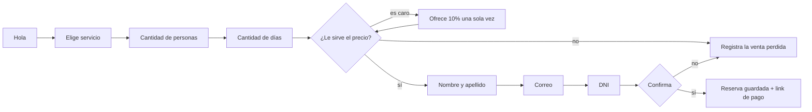

# 🌊 Marea — Bot de ventas por WhatsApp con panel web

> Un asistente que atiende por WhatsApp, cotiza, pide los datos del cliente y cierra la reserva solo. Y un panel web para ver qué se vendió, dónde se cae la gente y tomar el control cuando hace falta.

**Stack:** Node.js · Express · Next.js 14 · WhatsApp Cloud API · (opcional) Whisper para audios

<!-- Reemplazá estas líneas con tus links y capturas -->
**Demo online:** _[tu-link-en-vercel]_ · **Capturas:** guardalas en `docs/` y enlazalas acá.

---

## 1. Inicio: qué es

Marea es una aplicación completa en dos partes:

- **Bot de WhatsApp (backend en Node.js):** conversa con el cliente, entiende texto y audios, cotiza según el servicio, la cantidad de personas y los días, negocia un descuento si el precio le parece alto y registra la reserva.
- **Panel web (Next.js):** muestra métricas en vivo, el detalle de cada conversación y el listado de reservas con su estado de cobro.

Está pensado para negocios que venden por WhatsApp. El ejemplo del repo es el alquiler de carpas y sombrillas en un balneario, pero el catálogo se cambia en un solo archivo (`backend/src/catalog.js`).

## 2. El problema

Un negocio chico que vende por WhatsApp pierde plata de tres maneras:

1. **Responde tarde.** Quien pregunta a las 23 h por una carpa se va con la competencia que contestó primero.
2. **Repite siempre lo mismo.** Precios, disponibilidad, datos del cliente: todo a mano, mensaje por mensaje, y con errores.
3. **No sabe qué pasa.** No hay números: cuánta gente consulta, cuántos terminan comprando, en qué momento se pierden los clientes.

## 3. La solución

El bot guía la conversación paso a paso, valida cada dato y deja todo registrado:



### Funcionalidades

- Conversación por pasos con **validación** de nombre, correo y DNI.
- **Cotización automática** por servicio, tamaño de grupo y cantidad de días.
- **Negociación:** si el cliente dice que es caro, ofrece un descuento una sola vez.
- **Traspaso a una persona:** si el cliente pide un asesor, el bot se calla hasta que el equipo se lo devuelva desde el panel.
- **Audios:** los transcribe con Whisper (opcional, con `OPENAI_API_KEY`).
- **Panel con métricas:** conversaciones, conversión, ticket promedio, cobrado vs. por cobrar, embudo por etapa y reservas de los últimos 7 días.
- **Simulador integrado** para probar el bot sin conectar WhatsApp.
- **Seguridad:** verificación de la firma de Meta (`X-Hub-Signature-256`), clave de administración, deduplicación de mensajes reintentados y proxy para que el navegador nunca vea la clave.

## 4. Arquitectura

```
Cliente ──WhatsApp──▶ Meta Cloud API ──webhook──▶  backend (Express)
                                                    ├─ bot.js        máquina de estados
                                                    ├─ store.js      persistencia (JSON)
                                                    ├─ metrics.js    cálculo de métricas
                                                    └─ whatsapp.js   envío, audios
Panel (Next.js) ──/api (proxy con clave)──▶ backend /api/*
```

```
marea/
├── backend/
│   ├── src/ (server, bot, catalog, store, metrics, whatsapp, seed)
│   ├── test/bot.test.js
│   └── .env.example
├── frontend/
│   ├── app/ (resumen, chats, simulator, api proxy)
│   ├── lib/
│   └── .env.example
└── README.md
```

## 5. Cómo correrlo

Necesitás **Node.js 20 o superior**.

```bash
# Terminal 1: backend
cd backend
cp .env.example .env
npm install
npm run seed      # opcional: carga conversaciones y reservas de ejemplo
npm run dev       # http://localhost:4000

# Terminal 2: frontend
cd frontend
cp .env.example .env.local
npm install
npm run dev       # http://localhost:3000
```

Abrí `http://localhost:3000/simulator`, escribí **hola** y hacé una reserva completa. Después mirá el Resumen y Conversaciones.

### Tests

```bash
cd backend && npm test
```

Cubren el flujo completo, el descuento, las validaciones, el tramo "más de 6 personas" y el traspaso a un asesor.

## 6. Conectar WhatsApp real

1. Creá una app en [Meta for Developers](https://developers.facebook.com) y agregá el producto **WhatsApp**.
2. Copiá el **token** y el **Phone number ID** a `backend/.env` (`WHATSAPP_TOKEN`, `WHATSAPP_PHONE_ID`).
3. Elegí un `WHATSAPP_VERIFY_TOKEN` y poné el **App Secret** en `WHATSAPP_APP_SECRET`.
4. Desplegá el backend (Render, Railway) o exponelo con un túnel para pruebas.
5. En Meta, configurá el webhook en `https://TU-BACKEND/webhook`, con el mismo verify token, y suscribite a `messages`.

## 7. Endpoints

| Método | Ruta | Descripción |
|---|---|---|
| GET / POST | `/webhook` | Verificación y mensajes entrantes de WhatsApp |
| GET | `/api/metrics` | Métricas y embudo |
| GET | `/api/leads` | Reservas |
| PATCH | `/api/leads/:id` | Cambia el estado (`new`, `paid`, `lost`) |
| GET | `/api/conversations` | Lista de conversaciones |
| GET / PATCH | `/api/conversations/:phone` | Detalle y traspaso (`handoff`) |
| POST | `/api/simulate` | Prueba el bot sin WhatsApp |

## 8. Final: lo que sigue

- [ ] Reemplazar el archivo JSON por PostgreSQL o MySQL (solo cambia `store.js`).
- [ ] Enviar el email de descuento cuando el cliente dice que es caro.
- [ ] Disponibilidad real (stock de carpas por fecha) y calendario de reservas.
- [ ] Cobro integrado con Mercado Pago y confirmación automática del estado `paid`.
- [ ] Login para el panel y roles.
- [ ] Mensajes de seguimiento a quienes abandonan antes de confirmar.

## Autor

Hecho por **Nehuén Eizaga** · [LinkedIn](#) · [Portfolio](#)

Licencia MIT.
